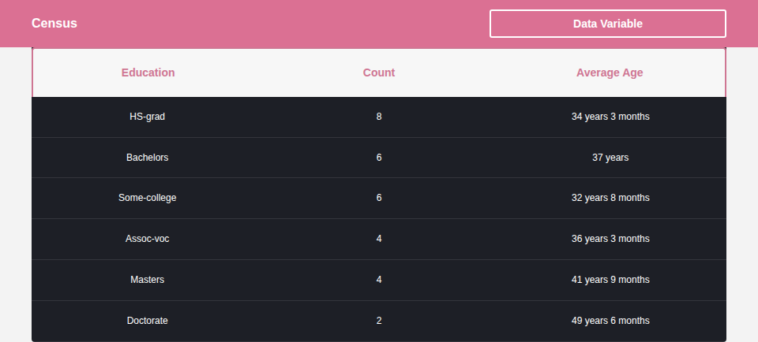

# Census dashboard

A React + TypeScript census explorer: pick a column, see grouped counts and average age. Built to show request cancellation (redux-saga takeLatest), explicit loading and error states, typed tests and CI.



A small explorer for a census table. The home page lists the columns. Choosing one opens `/explorer/<column>` and shows the most common values for that column, how many rows share each value, and the average age of those rows. The page also shows how many responses and distinct values sit outside that first page.

## Architecture

The client is React 16, Redux, and redux-saga. Express in front of MySQL-compatible SQL (census_learn_sql); local compose runs MariaDB 10.11 with a seeded table.

- **Actions** (`client/src/actions`) ask for the column list, ask for one page, or record the selected column.
- **Reducers** (`client/src/reducers`) keep three pieces of state: `censusVariableNames`, `activeCensusVariable`, and `censusPaginatedData` (rows, remaining counts, page number, and `idle` / `loading` / `success` / `error`).
- **Sagas** (`client/src/sagas`) perform the requests. `takeLatest` watches both the column-list request and the page request. When a new request of the same kind starts, redux-saga cancels the previous worker, so a slow response for an earlier column cannot overwrite the page the visitor is looking at now.
- **Services** (`client/src/services/api.ts`) call `/api/census/...`. One page is three reads in parallel: grouped rows, remaining total count, and remaining distinct-value count. If any read fails, the page fails. The API service (`api/src/services/census.ts`) runs the SQL.

The URL is the selected column. `/` renders the column cards. `/explorer/:variableName` renders the table. After the column list has loaded, a name that is not in that list is sent to `/catch`, which renders the 404.

## Run

```bash
docker compose up --build
```

Open http://localhost:4000. That command loads `db/seed.sql`. nginx listens on port 4000, proxies `/` to the client dev server, and strips `/api` before proxying to the API. Database settings for that stack are `SERVER_PORT` and `CENSUS_DB_*` in `docker-compose.yml`.

## Client or API only

Pinned to Node 12 because node-sass 4.13.1 only has prebuilds there; the upgrade is specified in openspec/changes/upgrade-client-stack. Yarn 1 is the package manager (`yarn.lock` in each package).

Client only, from `client/`:

```bash
yarn
yarn start:dev
```

That serves the UI at `http://localhost:3000`. The dev server does not proxy `/api`, so census requests from this process alone have nothing to answer them. Use the compose nginx (port 4000), or another proxy, when you need data.

API only, from `api/`. Copy `SERVER_PORT` and `CENSUS_DB_*` from `docker-compose.yml`, then:

```bash
yarn
yarn start:dev
```

## Test and build

From `client/` or `api/`:

```bash
yarn typecheck
yarn lint
yarn test --coverage=false --watchman=false
```

Pull requests run those three commands for both packages (`.github/workflows/ci.yml`, Node 12). Travis still builds the images and deploys; its deploy settings are unchanged. The API route tests mock the census service and do not need a database.

Production bundles:

```bash
cd client && yarn build    # webpack, output under client/dist
cd api && yarn build       # tsc, output under api/build
```

## OpenSpec

Behaviour is specified with [OpenSpec](https://github.com/Fission-AI/OpenSpec).

- `openspec/specs/` is the living spec (variable selection, page queries, the results table, source layout, and repository checks).
- `openspec/changes/` holds proposals that are not implemented yet.
- `openspec/changes/archive/` holds completed changes. Archiving merges each delta into the living spec.
- `openspec/config.yaml` records constraints, including leaving the deploy credentials and the current stack alone.

Two proposals are intentionally not implemented: `upgrade-client-stack` (React 18, Vite or a current webpack, ESLint, Testing Library, and `sass`) and `census-query-cache` (TanStack Query, with RTK Query as the single-store alternative).

## Known limitations

The remaining-count queries use `COUNT` with `LIMIT 0,100` (from `77213bf`), so they report 0 remaining. Left as is.
